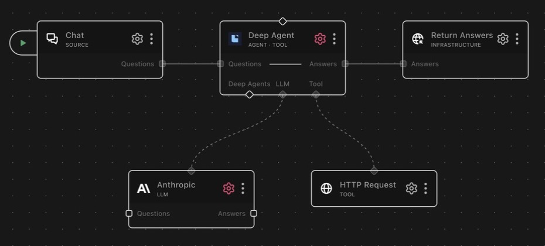

# agent_deepagent

A planning-capable RocketRide agent built on the Deep Agents library, with optional managed sub-agents for hierarchical delegation.

## About Deep Agents

Deep Agents is an open-source agent framework built on LangChain and
LangGraph. It layers the machinery long-running tasks need — upfront
planning, state that persists across steps, and long-context management — on
top of the standard tools-plus-LLM agent loop.

## What it does

Runs an agent loop via `deepagents.create_deep_agent` (built on LangChain/LangGraph), which layers strategic planning, persistent state, and long-context management on top of the standard LangChain tool-calling loop. The package ships two node variants:

- **Deep Agent** (`agent_deepagent`): the orchestrator. Consumes `questions` and produces `answers`, runs standalone with its own tools, and registers as a tool (`classType: ["agent", "tool"]`) so a parent agent can delegate to it via `<nodeId>.run_agent`.
- **Deep Agent Subagent** (`agent_deepagent_subagent`): a managed worker (`classType: ["deepagent"]`). It has no `questions` lane and cannot be invoked directly or called as a tool; it must be wired into a Deep Agent via the `deepagent` invoke channel, which delegates to it based on its `description`.

Sub-agents are optional: with none connected, the Deep Agent behaves as a standard single-agent node. Inference is routed through the host LLM channel using a JSON envelope protocol, so any LLM that can follow JSON instructions works; native function-calling support is not required. Agent lifecycle progress (tool calls, LLM calls, agent steps) is streamed as SSE `thinking` events.

## Example pipelines

**Research assistant with an HTTP tool**

`chat → agent_deepagent → response_answers`

`llm_anthropic` is wired to `llm` and `tool_http_request` to `tool`. Chat
questions reach the agent, which can call the HTTP tool before returning an
answer.

**Hierarchical team with specialists**

`webhook → agent_deepagent → response`, plus two Deep Agent Subagents on the
`deepagent` channel: a researcher (tools: `tool_exa_search`) and a coder
(tools: `tool_python`, `tool_github`), each with its own `llm`. The
orchestrator breaks the task apart and delegates each piece to the sub-agent
whose Description matches, and the plural `tool_calls` envelope lets it
delegate to several sub-agents in parallel in a single turn.

**Agent-callable research service**

A parent agent (e.g. `agent_rocketride`) with this Deep Agent connected as a
tool. With a filled-in Agent description, the parent invokes
`<nodeId>.run_agent` when it hits a question needing deep multi-step
research rather than attempting it in its own loop.

## Connections

### Deep Agent

| Channel     | Required    | Description                                                  |
|-------------|-------------|--------------------------------------------------------------|
| `llm`       | yes (min 1) | LLM used by the agent                                        |
| `tool`      | no          | Tools available to the agent (via control-plane invoke)      |
| `deepagent` | no          | Deep Agent Subagent nodes for hierarchical delegation        |

### Deep Agent Subagent

| Channel | Required    | Description                                    |
|---------|-------------|------------------------------------------------|
| `llm`   | yes (min 1) | LLM this sub-agent thinks with                 |
| `tool`  | no          | Tools available to this sub-agent              |

The sub-agent's LLM and tool channels are independent of the orchestrator's. When the orchestrator delegates, the sub-agent's LLM and tool calls are routed back through this node's own channels.

## Lanes

| Lane in     | Lane out  | Description                                     |
| ----------- | --------- | ----------------------------------------------- |
| `questions` | `answers` | Send the agent a task, receive its final answer |

Deep Agent only. The Subagent declares no lanes; it is driven by an
orchestrator, not by direct questions.

## As a tool

The Deep Agent (not the Subagent) exposes itself as an invokable tool, `<nodeId>.run_agent`, so parent agents can delegate to it in nested pipelines.

- **Input:** `{query: string, context?: object}`. `query` must be a non-empty string; `context`, when provided, is attached to the question as a `RocketRide.agent.tool_context.v1` JSON payload.
- **Output:** `{content, meta, stack}`. `meta` holds the framework, agent and run ids, timings and the tool-call count; it carries `stop_reason` when the run reports why it stopped (`error` when it raised, or when the `require_tool_call` guard refused its answer), and no `stop_reason` means none was reported, not that the run finished. The task's control token is never included.

When `agent_description` is non-empty it is included in the tool's description so parent agents can select this agent correctly.

## Configuration

Both variants are steered the same way: by default you add **Instructions**,
and turning on **Advanced Mode** swaps them for direct prompt fields. The
field-level details:

### Description (Subagent)

The most important field on a sub-agent. The orchestrating Deep Agent reads
**only this text** when deciding which sub-agent gets a task — it cannot see
the sub-agent's prompt, tools, or LLM. Keep it specific and action-oriented:
"Searches the web and summarizes findings with sources" gets routed work;
"helper agent" never gets picked. If a sub-agent sits idle while the
orchestrator does everything itself, fix this field first.

### Agent description (Deep Agent)

The same idea one level up: when the Deep Agent is used as a tool by a parent
agent, this text is folded into the `run_agent` tool description so the
caller can decide when to invoke it. Leave it blank if nothing calls this
agent as a tool.

### Instructions, System prompt & Advanced Mode

With Advanced Mode **off** (the default), you steer the agent by adding
Instructions — each non-empty line is appended, on its own line, to the
built-in system prompt that already handles planning and state. With Advanced
Mode **on**, the Instructions list is replaced by the raw prompt fields
(`system_prompt`, and `agent_description` on the orchestrator) for full
control; a blank `system_prompt` falls back to the built-in default. Stay in
default mode unless the built-in prompt is actively in your way — replacing
it discards the planning behavior that makes Deep Agents worth choosing.

### Require tool call

Smaller or weaker planning models occasionally **narrate** a multi-step tool
chain in prose instead of actually calling the tools, producing a
plausible-looking but ungrounded answer. When this toggle is on, any run that
produces an answer without invoking at least one tool fails with a
`RocketRide.agent.guard.v1` error instead of delivering the ungrounded text.
Off by default; enable it for determinism-critical pipelines. The guard
counts real tool invocations only — internal/local reads (for example the
wave agent's `memory.peek`) do not satisfy it.

## Notes

### Tool calling protocol

The host LLM is opaque to the driver, so tool calling uses a JSON envelope protocol: each LLM call is prefixed with a system preamble. **Tool calls are JSON; an answer to the person is not.**

- Single tool call: `{"type":"tool_call","name":"server.tool","args":{...}}`
- Parallel tool calls: `{"type":"tool_calls","calls":[{"name":"...","args":{...}}, ...]}`
- Final answer: `FINAL>>>` followed by the answer as plain text

**Why the answer left JSON.** Arguments are structured data, where JSON earns its keep. An answer is prose, and the JSON form asked the model to escape a whole markdown table into a string value — one missed inner quote and the envelope stopped parsing, so the person read the envelope instead of the answer. After `FINAL>>>` there is nothing left to escape, and the text is delivered exactly as written. The `{"type":"final","content":"..."}` shape is still accepted by the parser for any model that emits it; it is no longer what the preamble asks for.

"Exactly as written" is literal: only the separator between the marker and the answer is removed, which is one LF, CRLF or CR newline, or one space or tab on the same line. Whitespace after that belongs to the answer, so `FINAL>>>` followed by an indented line still arrives as a markdown code block. Two things are not delivered as written: whitespace at the very end of the reply is trimmed, and text after the marker that is itself a `{"type":"final"}` envelope is unwrapped to its content.

Reply parsing, final-answer recovery and the three-attempt retry loop are
shared with `agent_langchain` in `ai.common.agent._internal.protocol`. The
DeepAgent prompt and asynchronous execution are unchanged, and only DeepAgent
enables the parallel `tool_calls` form.

The sentinel opens a line. A tool call before it takes precedence, the plural
form included: a claim about work that has not run is not delivered. The
reply is then read as its first JSON object, so a tool call there runs and
anything else is retried. A tool call that does not parse takes precedence
wherever it sits. One that parses with a word before it and a word after it
on its line is quoted and does not override the sentinel, and one wrapped
inside another object that parses is not read. A marker inside or after a broken
`final` envelope is ambiguous and the reply is retried. A `final` envelope kept after the
marker is unwrapped; a truncated one is retried. A whole tool-call envelope
after the marker is retried with guidance to omit the marker, and a valid
`final` followed by pending tool work is also retried instead of delivering
its claim. A new closed markdown block after a parsed final quotes examples,
including malformed calls, and does not prevent delivery of that final. Calls
outside that block, in the final's own fence, or in an unclosed block remain
pending work. LF, CRLF and bare CR all start a new `FINAL>>>` line.

Without a sentinel the first JSON object in the reply is the envelope, also
inside a markdown fence, after a line of prose, or inside a JSON array.
Objects after the first one are not read: of two tool calls sent
as a bare array only the first runs, so several calls belong in one
`tool_calls` envelope. Non-string `final` content is serialized as JSON. Tool
arguments that are not an object are passed as `{"input": value}`, the values
`false`, `0`, `""` and `[]` included; only a missing or `null` `args` becomes
`{}`. A malformed `final` envelope is recovered only when it opens the reply
and closes it; one that was cut off, or is followed by more text, by other
members (including strings with broken escaping) or by a second envelope, is retried. An answer cut off exactly at an
unescaped inner `"}` can look complete.

A preamble containing braces or ordinary JSON no longer hides a standalone
envelope on a later line. Nested objects, quoted examples and template
wrappers are not newly dispatched; an ambiguous mix with `FINAL>>>` is
retried. Final recovery accepts fence labels such as `json5`, `c++` and
`objective-c`. The marker itself must be plain: markdown wrappers such as
`**FINAL>>>**` are not recognized.

Each retry describes what broke and asks for either a regenerated tool call or
an answer after `FINAL>>>`. Ordinary prose is delivered after three attempts,
also when it starts with a brace that opens no object (`{curly} braces`).
This deliberately retains up to three model calls and their latency and
token cost. Hints include only an excerpt of the failed reply, so they ask
the model to generate the call from the task and tool schema. A parsed
`final` with missing, null, empty or whitespace-only content remains a
successful answer for compatibility. An
empty reply, a `FINAL>>>` with nothing after it, a reply that opens with a
JSON object that is neither shape, a tool call or an answer that never parsed,
and an object that has a tool call's `name` and `args` and no `type`, is not
quoted, and is the reply's first object or has no word before it on its line
are not answers: the run fails with `stop_reason: error`. Explicit code
expressions (`return`/`yield`, assignments, arrow functions and same-line function
arguments, including later comma-separated arguments inside an open parenthesis)
are exempt from the first-object rule only when deciding whether to deliver prose
after three attempts; prose such as `Calling: {...}` is not. When accepting a
final claim or choosing its retry hint, a code dictionary with `name` and `args`
before `FINAL>>>` or a `final` envelope is pending work. The claim is withheld
and the model is asked to regenerate the call. A real code example in that
position cannot be distinguished from an unexecuted call and is refused too. That holds
for a sub-agent's turn too, and a sub-agent turn that fails this way fails the
orchestrator's run. The returned error contains the reason and position,
while excerpts of the model's reply go only into the repair hint. Whitespace
around a reply is trimmed before parsing. Recovery decodes recognized JSON
escapes, including `\n`, `\t`, `\b` and `\f`; unknown escapes remain
literal. A malformed envelope cannot distinguish a literal Windows-path
backslash from a recognized escape. Use escaped backslashes in JSON or
`FINAL>>>` for literal paths. Recovery joins valid surrogate pairs and keeps
unpaired surrogates as their original `\uXXXX` escape text, preserving UTF-8
encodability. Parsed final content also preserves lone surrogates as literal
`\uXXXX` escapes, including after `FINAL>>>` and in object or array content.
Valid Unicode characters and surrogate pairs keep their decoded values.

A damaged first key or an early closing brace does not hide a tool-call
type in the remaining members. The reply is retried as a call, and a claim
after `FINAL>>>` is not delivered. This is conservative: an unreadable object
followed by text naming a tool-call type may be retried even when it was
intended as an example. Standalone `final` envelopes with unquoted or
single-quoted keys are also retried, including in a fence or after the marker.

The plural `tool_calls` form dispatches entries concurrently through LangGraph's
async ToolNode. Host tools use typed Pydantic input schemas built from their
JSON-Schema `inputSchema`; tool execution and LLM calls run off the event loop
via `asyncio.to_thread` so concurrent calls do not serialize.

### Hierarchical delegation

Connect one or more Deep Agent Subagent nodes to the `deepagent` invoke channel to turn the Deep Agent into an orchestrator. On each run:

1. The orchestrator fans out a `describe` invoke to every connected Subagent node.
2. Each sub-agent returns its name, description, system prompt, instructions, and a reference to its own engine channels.
3. The orchestrator builds a `deepagents.middleware.subagents.SubAgent` record per descriptor, wiring each sub-agent's LLM and tools to its own channels, and passes them to `create_deep_agent(subagents=...)`.
4. The orchestrator's LLM gains a `task(description, subagent_type)` tool it calls to delegate work. Each sub-agent runs in its own `AgentContext` that inherits the run metadata, so SSE events route back to the same logical run.

Give each sub-agent its own LLM, tools, and a clear `description`: the description is the only signal the orchestrator uses to choose a delegate. A Subagent can be connected to multiple orchestrators simultaneously; each orchestrator independently includes it in its own hierarchical run. A `describe` failure on one node is logged and skipped, not fatal to the run.

### Observability

The driver emits SSE `thinking` events throughout a run: host-tool discovery count, sub-agent collection count, agent start, per-tool start/completion/error (with tool name and input length), LLM call start/completion/error, and agent thinking/done transitions.

## Upstream docs

- [Deep Agents documentation](https://docs.langchain.com/oss/python/deepagents/overview)
- [LangChain documentation](https://python.langchain.com/docs/)

---

<!-- ROCKETRIDE:GENERATED:PARAMS START -->
<!-- Generated by nodes:docs-generate. Do not edit by hand. -->

## Schema

### Deep Agent (`services.agent.json`)

| Field | Type | Description | Default |
|---|---|---|---|
| `advanced_mode` | `boolean` | **Advanced Mode** When enabled, replace the Instructions list with direct Agent Description and System Prompt fields for full control. | `false` |
| `agent_description` | `string` | **Agent description** What does this agent do? Describe its purpose and capabilities, this helps parent agents select and invoke it correctly. | `""` |
| `instructions` | `array` | **Instructions** Additional instructions to guide the agent. Each line is appended to the system prompt. |  |
| `require_tool_call` | `boolean` | **Require tool call** Require the agent to invoke at least one tool before answering. When on, a run that answers without calling any tool fails with a guard error. Use for determinism-critical pipelines where an ungrounded or narrated answer must never be delivered. Off by default. | `false` |
| `system_prompt` | `string` | **System prompt** Instructions that define this agent's role and behaviour. Leave blank to use the default. | `""` |

### Deep Agent Subagent (`services.subagent.json`)

| Field | Type | Description | Default |
|---|---|---|---|
| `advanced_mode` | `boolean` | **Advanced Mode** When enabled, replace the Instructions list with a direct System Prompt field for full control. | `false` |
| `description` | `string` | **Description** The orchestrator reads this description to decide when to delegate to this sub-agent. Keep it specific and action-oriented, this is the only signal the orchestrator uses to pick a sub-agent. | `""` |
| `instructions` | `array` | **Instructions** Additional instructions to guide this sub-agent. Each line is appended to the system prompt. |  |
| `system_prompt` | `string` | **System prompt** Instructions that define this sub-agent's role and behaviour. Leave blank to use the default. | `""` |

## Dependencies

- `deepagents`
- `langchain`
- `langchain-core`
- `pydantic`

## Source

[<svg viewBox="0 0 16 16" width="15" height="15" fill="currentColor" aria-hidden="true" style="vertical-align:-0.15em;margin-right:0.35em"><path d="M8 0C3.58 0 0 3.58 0 8c0 3.54 2.29 6.53 5.47 7.59.4.07.55-.17.55-.38 0-.19-.01-.82-.01-1.49-2.01.37-2.53-.49-2.69-.94-.09-.23-.48-.94-.82-1.13-.28-.15-.68-.52-.01-.53.63-.01 1.08.58 1.23.82.72 1.21 1.87.87 2.33.66.07-.52.28-.87.51-1.07-1.78-.2-3.64-.89-3.64-3.95 0-.87.31-1.59.82-2.15-.08-.2-.36-1.02.08-2.12 0 0 .67-.21 2.2.82.64-.18 1.32-.27 2-.27.68 0 1.36.09 2 .27 1.53-1.04 2.2-.82 2.2-.82.44 1.1.16 1.92.08 2.12.51.56.82 1.27.82 2.15 0 3.07-1.87 3.75-3.65 3.95.29.25.54.73.54 1.48 0 1.07-.01 1.93-.01 2.2 0 .21.15.46.55.38A8.013 8.013 0 0016 8c0-4.42-3.58-8-8-8z"/></svg> View source](https://github.com/rocketride-org/rocketride-server/tree/develop/nodes/src/nodes/agent_deepagent)
<!-- ROCKETRIDE:GENERATED:PARAMS END -->
