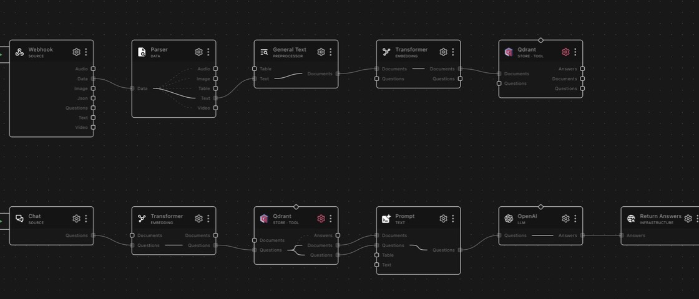

# store_qdrant

A RocketRide vector store node backed by Qdrant, for storing embedded documents and retrieving them by semantic or keyword search.

## About Qdrant

Qdrant is an open-source vector database built for similarity search at scale.
It stores high-dimensional embeddings and returns the closest matches to a
query vector, with filtering and payload support, and runs self-hosted or as a
managed service (Qdrant Cloud).

## What it does

Stores pre-embedded document chunks in a Qdrant collection and retrieves them by semantic (vector) similarity or full-text keyword search. Works with both self-hosted Qdrant and Qdrant Cloud. The node is also a tool node (`classType: ["store", "tool"]` with the `invoke` capability), so agents in the same pipeline can use the eight functions documented under As a tool, including document retrieval, statistics, trash and restore, subject to the tool-exposure and write-permission settings.

Uses the official **`qdrant_client`** Python SDK over REST (`prefer_grpc=False`, 60-second timeout). If the configured host has no scheme, `http://` is prepended automatically.

Documents must be run through an embedding node before reaching this node: the store does not compute embeddings on the data lane and raises an error if a chunk arrives without one.

The collection is created automatically on first write, including payload indexes on `meta.nodeId`, `meta.objectId`, `meta.parent`, `meta.permissionId`, `meta.isDeleted`, `meta.isTable`, and a full-text index on `content` (word tokenizer, lowercase, token length 2-15). Writing chunk 0 of an object first deletes all existing points with the same `objectId`, so re-ingesting a document replaces it rather than duplicating it. Upserts are batched: a flush happens every 500 points or when the accumulated payload exceeds the payload limit (32 MiB by default).

## Example pipelines

**End-to-end RAG pipeline**

`webhook → parse → preprocessor_langchain → embedding_transformer → qdrant`

`chat → embedding_transformer → qdrant → prompt → llm_openai → response_answers`

Documents are parsed, chunked, embedded, and stored in Qdrant. Chat questions
use the same embedding and Qdrant retrieval path before the prompt and LLM
produce an answer.

**Question answering over stored documents**

`webhook → embedding_transformer → store_qdrant → llm_anthropic → response`

The question is embedded, this node enriches it with the most relevant stored
documents (`questions` → `questions` lane), and the LLM answers from that
retrieved context.

**Agent with searchable memory**

An agent with this node connected as a tool: it calls `search` for context
when it decides it needs it, and `upsert`s new facts as it works — a knowledge
base the agent reads and writes on demand instead of retrieval running on
every question.

## Lanes

| Lane in     | Lane out    | Description                                                      |
| ----------- | ----------- | ---------------------------------------------------------------- |
| `documents` | —           | Ingest pre-embedded documents into the collection                |
| `questions` | `documents` | Return matching documents                                        |
| `questions` | `answers`   | Return matching documents as an answer                           |
| `questions` | `questions` | Enrich the question with matching documents for downstream nodes |

## As a tool

Pipeline agents address the functions as `<node id>.<function>`. The configured `serverName` (default `qdrant`) labels tool-response messages. The available functions are `search`, `objdir`, `get`, `stats`, `upsert`, `delete`, `soft_delete`, and `restore`; write functions require `allow_write`, and all functions require `expose_tools`.

### `search`

Semantic similarity search over the collection.

| Argument | Type    | Description                                                               |
| -------- | ------- | ------------------------------------------------------------------------- |
| `query`  | string  | Required. The search query text.                                          |
| `top_k`  | integer | Maximum results to return (default 10, capped at 100).                    |
| `filter` | object  | Optional metadata filter; supports `objectId`, `nodeId`, and `parent` keys. |

Requires an embedding provider bound to the node (the embedding sub-block in the configuration). If semantic search fails, the tool falls back to keyword search. Returns `{"results": [{content, score, metadata}], "total": n}` on success or `{"success": false, "error": "..."}` on failure.

### `objdir`

List the distinct parent paths of active documents in the collection as a map of parent path to one object ID each. Takes optional `parent` (a text match on the stored parent, not an exact path), `offset` and `limit` (default and cap 1000). `offset` and `limit` count documents, not paths: documents that share a parent path appear as one entry, so a page can hold fewer than `limit` entries while more follow. Qdrant's scroll offset is a point-ID cursor, so each page reads `offset + limit` points from the start of the collection, in requests of at most 1,000 points, and skips the first `offset`.

### `get`

Return the chunks of one document. Takes a required `object_id` and optional `offset` and `limit` (default and cap 100); chunks come ordered by chunk ID with `total`, `has_more` and `truncated`. An object ID the collection does not hold, or one in the trash, returns `{"success": false, "error": "..."}`.

### `stats`

Return the collection's point count as Qdrant reports it, `document_count` (null on this store, which does not list documents), the embedding model name and the vector size.

### `upsert`

Add or update documents in the collection.

Each item in the `documents` array requires `content` and `object_id` (used for deduplication) and may include `metadata` (keys `nodeId`/`parent`/`chunkId` are stored; `nodeId` defaults to `"vectordb_tool"`, `parent` to `"/"`, and `chunkId` to the position among the chunks sent for that object ID in the call, 0 for the first; an explicit `chunkId` may not repeat within the call), plus optional pre-computed `embedding` and `embedding_model` to skip automatic embedding. Without a pre-computed vector the node's bound embedding provider is used; if none is configured the call fails. Returns `{"success": true, "count": n, "skipped": n}`.

### `delete`

Delete documents by ID.

Takes a required `object_ids` string array and removes all points whose `meta.objectId` matches. Returns `{"success": true, "deleted_count": n}`.

### `list_documents`

List the documents one by one, with their path and chunk count, in pages ordered by path.

Pass the previous answer's `next_cursor` as `cursor` for the next page. `deleted` is `'active'` (default), `'deleted'` (the trash) or `'all'` (`true` and `false` stand for `'deleted'` and `'active'`); `parent` keeps the documents stored under exactly that path. Returns `{"success": true, "items": [...], "next_cursor": ..., "total": n}`.

### `soft_delete`

Move documents to the trash by ID.

Takes a required `object_ids` string array. The chunks stay stored but leave search, `objdir`, `get` and the listing until `restore`. Returns `{"success": true, "object_ids": [...], "matched_chunks": n, "moved_chunks": m, "not_found": [...]}`, where `moved_chunks` counts the chunks moved and `matched_chunks` the chunk rows the store holds for those IDs.

### `restore`

Take documents out of the trash by ID.

Takes a required `object_ids` string array; a document not in the trash is left as it is. Returns the same shape as `soft_delete`.

## Profiles

Default: **Qdrant cloud server** (`cloud`).

| Profile                         | Default host                   | Default port |
| ------------------------------- | ------------------------------ | ------------ |
| Qdrant cloud server **(default)** | _(your Qdrant Cloud endpoint)_ | `6333`       |
| Your own Qdrant server          | `localhost`                    | `6333`       |

## Configuration

Choose the host type (cloud or self-hosted), point the node at your Qdrant
endpoint, and name the collection. Most deployments only ever touch the host,
API key, and collection fields.

### Tool Server Name

The name defaults to `qdrant` and labels this store in tool-response messages.
Pipeline agents address all eight functions documented above by node ID, for
example `<node id>.search` or `<node id>.restore`; changing this label does not
change those addresses.

### Write switches

Allow document management from tool calls (`allow_writes`) is off by default.
Turn it on in the pipeline whose Tools source should be able to remove
documents from the collection, or add them with the `upsert` tool, through
tool calls, for example the pipeline the Vector Explorer manages. Even when it
is on, such a write is accepted only from a Tools source of the pipeline,
addressed to this node; calls from the pipeline's chat or ingest sources are
refused. Documents the pipeline's own lanes write are not affected by this
switch.

The switch does not apply to an agent in this pipeline: its `upsert` and
`delete` calls work as they always have.

## Authentication

Self-hosted Qdrant typically needs no credentials: leave `apikey` empty. For Qdrant Cloud, set `host` to your instance endpoint (`<instance>.<region>.qdrant.io`) and provide the cluster API key in `apikey`. The key is passed as the `api_key` argument of the Qdrant client.

## Notes

### Scoring and relevance

Raw Qdrant scores are rescaled before filtering, so that a higher score always means a closer chunk. For `Cosine` and `Dot` similarity the rescaling is `(score + 1) / 2`, which is `[0, 1]` for unit-length (normalised) embeddings: an identical vector scores 1.0 and an opposite one 0. For `Euclid` and `Manhattan`, whose raw score is a distance, it is `1 / (1 + distance)`. Earlier versions of this node applied a sigmoid to `Dot` scores, which put every result near 0.5; thresholds tuned against those scores need revisiting. Results below a floor of `0.20` are dropped as noise unless the caller sets its own minimum score (the Vector Explorer does, to show what the floor hides), and the configured retrieval `score` threshold is applied on top of that in the rescaled space (applied by the base store, not passed to Qdrant as `score_threshold`).

The similarity metric defaults to `Cosine`; `Euclid`, `Dot`, and `Manhattan` are also accepted. Any other value raises a configuration error at startup. Semantic search uses exact search (`SearchParams(exact=True)`) and does not support a non-zero result offset. Keyword search and plain filtered gets do: a numeric offset skips that many matching chunks (Qdrant's own scroll offset is a point id, so the node walks the matches in id order). A `parent` filter matches the exact path, also when listing paths.

Deletion of source files is handled as a soft delete: `isDeleted` is set to `true` inside each chunk's `meta` payload (the rest of `meta` is kept) and the chunks are excluded from all searches by default. They are only returned when the filter explicitly asks for deleted documents. A document that reappears is marked active again.

### Point ids

Each chunk is stored under a point id derived from its document and position, `uuid5(NAMESPACE_URL, '<objectId>#<chunkId>')`, so a chunk always maps to one point and re-ingesting a document overwrites its points in place. Collections written by earlier versions of this node hold random point ids; every read by document and chunk falls back to a payload filter for those, so old and new collections work alike.

### Vector Explorer

The node answers the Vector Explorer's store calls natively. Documents are listed from their first chunks in storage order (the app sorts what it has loaded), with chunk and table counts from exact facets. The first page counts every document once; documents whose first chunk is missing (every document minus those with a first chunk) are listed after the others, from a list built once per listing. Counts and that sweep are exact up to 10,000 distinct documents; above that the total is unknown and the listing says its count is capped. Above the cap the sweep covers the 10,000 most-chunked documents and reads their first chunks rather than faceting over that list: on Qdrant 1.17.1 an exact facet over 10,000 ids took 17 to 35 seconds, while reading their first chunks takes about 0.1 second, so a 10,503-document listing pages through in about 1.3 seconds with no page above 0.2 second. A collection created outside this node may lack the keyword index on `meta.objectId` that Qdrant needs for facets; such a collection is counted by reading its rows instead (up to 200,000 rows).

The neighbour graph for the map is computed by Qdrant itself (the distance-matrix API, restricted to the sampled points) for samples of up to 500 points; larger samples, the explorer's default of 1,000 included, are computed on the node, and the explorer reports which one computed it. Qdrant's memory for that call grows faster than the sample and stays allocated afterwards, even after the collection is dropped: on Qdrant 1.17.1, 500-point graphs left nothing measurable, while 1,000-point graphs left between about 125 MB (a 3,000-point collection) and 630 MB (eight graphs on a 12,000-point collection). Either way the similarities are recomputed from the vectors, so every view uses one definition. Random samples come from Qdrant's random sampling, which takes no seed.

### Save-time validation

When the configuration is saved, the node validates it with a fast read-only probe (`get_collections`, 10-second timeout):

- The collection name must match `^[A-Za-z0-9._-]{1,255}$`: no `/` or spaces.
- Port `0` is rejected explicitly.
- Scheme is inferred when the host has none: `http` for `localhost` or `127.*`, `https` for `*.qdrant.io` hosts or port `443`.
- Qdrant Cloud with a wrong port does not return an HTTP status: the probe simply times out after 10 seconds and surfaces a timeout warning.

### Language support and rehydration

- Qdrant's full-text tokenizer does not support all languages out of the box. Chinese, Japanese, and Korean are not enabled in the default Qdrant build and require building Qdrant from source with the `--features multiling-chinese,multiling-japanese,multiling-korean` flags. This only affects keyword search over the `content` payload; semantic search uses the embeddings you provide and is unaffected.
- Rendering a full document rehydrates all of its chunks in `chunkId` order, fetching them in batches of up to 32 MiB and joining them, so out-of-order storage is handled transparently.

## Upstream docs

- [Qdrant documentation](https://qdrant.tech/documentation/)

---

<!-- ROCKETRIDE:GENERATED:PARAMS START -->
<!-- Generated by nodes:docs-generate. Do not edit by hand. -->

## Schema

| Field | Type | Description | Default |
|---|---|---|---|
| `qdrant.profile` | `string` | **Type of Qdrant host** Connect to... | `"cloud"` |
| `qdrant.provider` | `string` |  | const: `"qdrant"` |
| `qdrant.serverName` | `string` | **Tool Server Name** Label for this store in tool-response messages (for example, a refused write names qdrant.delete). Pipeline agents address the available functions as node-id.function; apps use the function name and node ID. Changing this label does not change those addresses. See the node README for the available functions and their tool-exposure and write-permission settings. | `"qdrant"` |
| `vector.cloud.host` |  | Enter the server IP address e.g. <your-instance-name>.<region>.qdrant.io |  |
| `vector.cloud.port` |  |  | `6333` |
| `vector.local.host` |  |  | `"localhost"` |
| `vector.local.port` |  |  | `6333` |

## Dependencies

- `grpcio`
- `grpcio-tools`
- `portalocker`
- `pydantic`
- `urllib3`
- `httpx`
- `qdrant_client` `==1.17.1`
- `numpy`

## Source

[<svg viewBox="0 0 16 16" width="15" height="15" fill="currentColor" aria-hidden="true" style="vertical-align:-0.15em;margin-right:0.35em"><path d="M8 0C3.58 0 0 3.58 0 8c0 3.54 2.29 6.53 5.47 7.59.4.07.55-.17.55-.38 0-.19-.01-.82-.01-1.49-2.01.37-2.53-.49-2.69-.94-.09-.23-.48-.94-.82-1.13-.28-.15-.68-.52-.01-.53.63-.01 1.08.58 1.23.82.72 1.21 1.87.87 2.33.66.07-.52.28-.87.51-1.07-1.78-.2-3.64-.89-3.64-3.95 0-.87.31-1.59.82-2.15-.08-.2-.36-1.02.08-2.12 0 0 .67-.21 2.2.82.64-.18 1.32-.27 2-.27.68 0 1.36.09 2 .27 1.53-1.04 2.2-.82 2.2-.82.44 1.1.16 1.92.08 2.12.51.56.82 1.27.82 2.15 0 3.07-1.87 3.75-3.65 3.95.29.25.54.73.54 1.48 0 1.07-.01 1.93-.01 2.2 0 .21.15.46.55.38A8.013 8.013 0 0016 8c0-4.42-3.58-8-8-8z"/></svg> View source](https://github.com/nihalnihalani/rocketride-server/tree/develop/nodes/src/nodes/store_qdrant)
<!-- ROCKETRIDE:GENERATED:PARAMS END -->
