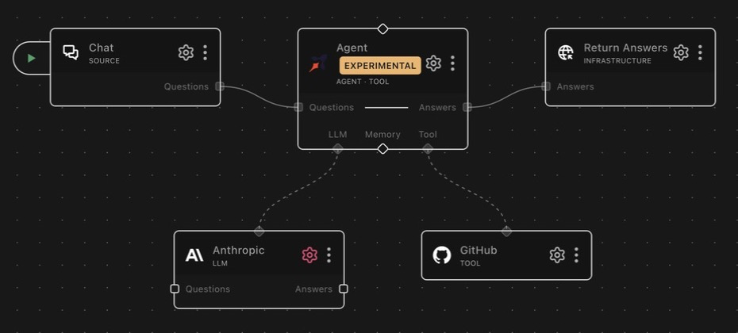

# tool_github

A RocketRide tool node that exposes GitHub repository operations to an AI agent.

## About GitHub

GitHub is the world's largest code-hosting platform, built on git. Teams use it
for source control, code review, issue tracking, releases, and CI/CD automation
via GitHub Actions.

## What it does

Exposes selected GitHub REST operations: files, issues, pull requests, reviews,
repository trees and metadata, releases, workflows, organizations, users, search,
and commit history. Useful for agents that manage codebases, triage issues,
automate releases, or operate CI/CD pipelines.

Uses the **requests** library to call the GitHub REST API v3 (`https://api.github.com`,
API version `2022-11-28`) with Bearer-token auth and a 30-second request timeout. API
responses are stripped of noisy fields (`node_id`, `_links`, gravatar data, etc.) so the
agent gets compact, useful output.

Authentication is **required**: the pipeline fails to start without either a personal
access token or a complete GitHub App configuration. Write operations are **allowed by
default**; enable **read-only mode** to block every mutating tool when the agent should
only inspect.

## Example pipelines

**GitHub assistant**

`chat → agent_rocketride → response_answers`

<div align="center">



[](example.pipe)

</div>

`llm_anthropic` is wired to `llm` and `tool_github` to `tool`. Chat questions
reach the agent, which can inspect or update the configured repository before
returning an answer.

**Read-only codebase analyst**

An agent with this node as a tool and read-only mode **on**: it can search
code, read files, and summarize pull requests, with every mutating call
blocked at dispatch — safe to point at production repositories.

**Release automation**

`webhook → agent_deepagent → response`, with this node plus `tool_python` as
tools. The agent drafts release notes from `commit_list`, creates the release
with `release_create`, and dispatches the publish workflow with
`workflow_dispatch`.

## As a tool

List tools accept `per_page` (1–100, default 30) and `page` (default 1) for pagination.

Most tools accept an optional `repo` parameter (`owner/repo`). If omitted, the configured
`defaultRepo` is used; if neither is set, the call fails with an error asking for a repo.

### Files

| Tool | Description |
|---|---|
| `file_get` | Get the decoded content and metadata of a single file; files over 1 MB through the Git blob API, up to `max_bytes` (default 1 MiB, so a file over 1 MB needs a `max_bytes`) |
| `file_list` | List files and directories at a path (one directory, at most 1,000 entries, GitHub's Contents API limit, with no truncation flag); use `repo_tree` for a whole tree |
| `file_create` | Create a new file |
| `file_edit` | Update an existing file. Requires the current file SHA (get it from `file_get` first) |
| `file_delete` | Delete a file. Requires the current file SHA (get it from `file_get` first) |

`file_get` raises an error when the path is a directory (use `file_list`), and
`file_list` raises when the path is a file (use `file_get`). Reads accept an optional
`ref` (branch, tag, or commit SHA); writes accept an optional `branch` and commit
`message`.

GitHub's Contents API carries file content up to 1 MB. For a larger file `file_get`
reads the blob the metadata names (`GET /repos/{repo}/git/blobs/{sha}`), which GitHub
serves up to 100 MB, so the result is complete and matches the returned `sha` and
`size` (a blob body whose length differs from `size` is withheld with a message rather
than returned). When GitHub cannot serve the content, for a file the Contents API refuses as
too large (over 100 MB) or when the blob read fails, `content` is `null` and `message`
says why and what to do instead (download it from `download_url`, or clone the
repository with `tool_git`). A large file with a NUL byte in its first 8000 bytes is
binary by git's own rule and is reported the same way instead of being returned as
replacement characters. None of these cases raises, whether the blob read failed with
an HTTP status, a transport error or an invalid body; the metadata request itself
still raises as before, and `found: false` still marks a missing path.

`max_bytes` (an integer from 1048576 to 104857600, default 1048576, that is 1 MiB) caps
the files the blob path downloads. The default is the Contents API's own boundary, so a
pipeline written before this option sees no larger payloads than before: a file over 1 MB
is reported, not downloaded, until the call asks for it. The size comes with the metadata,
so a larger file is
refused before its blob is read: `found: true`, `content: null`, its `size`, and a
`message` naming the size and the cap and saying that a larger `max_bytes` may be passed.
Files of 1 MB or less arrive with the metadata and are returned as before. A blob read
takes roughly four times the file's size in memory while the base64 body, its bytes and
the decoded text exist together (about 200 MB for a 50 MB file), so raise the cap only for
a file you need whole.

### Issues

| Tool            | Description                                              |
|-----------------|----------------------------------------------------------|
| `issue_get`     | Get a single issue by number                             |
| `issue_list`    | List issues (filter by state, labels, assignee)          |
| `issue_create`  | Create a new issue (title, body, labels, assignees)      |
| `issue_comment` | Post a comment on an issue                               |
| `issue_edit`    | Edit an issue (title, body, state, labels, assignees)    |
| `issue_lock`    | Lock an issue to prevent further comments                |

GitHub's issues endpoint includes pull requests; `issue_list` filters them out, and
`issue_get` raises an error for PR numbers (use `pr_get`).

### Pull requests

| Tool        | Description                                                  |
|-------------|--------------------------------------------------------------|
| `pr_get`    | Get a single pull request by number                          |
| `pr_list`   | List pull requests (filter by state, base branch)            |
| `pr_create` | Create a pull request (title, head, base, body, draft flag)  |

### Reviews

| Tool            | Description                                                       |
|-----------------|-------------------------------------------------------------------|
| `review_create` | Submit a PR review: `APPROVE`, `REQUEST_CHANGES`, or `COMMENT`  |
| `review_list`   | List all reviews on a pull request                                |
| `review_get`    | Get a single review                                               |
| `review_update` | Update the body of a pending review                               |

### Repository

| Tool                | Description                                                                              |
|---------------------|------------------------------------------------------------------------------------------|
| `repo_get`          | Repository metadata (stars, forks, language, default branch, etc.)                       |
| `repo_tree`         | Tree for `repo` and optional `ref`, sorted by path, with `truncated` and `complete`; `walk` completes a truncated tree |
| `repo_contributors` | One page of contributors: `login`, `contributions`, `type`                               |
| `repo_languages`    | Language names mapped to byte counts                                                     |
| `label_list`        | One page of repository labels: `name`, `color`, `description`                            |

`repo_tree`, `repo_contributors`, `repo_languages`, `label_list` and `user_get` return an
explicit response envelope:

```json
{
  "status": 200,
  "data": [{ "name": "bug", "color": "d73a4a", "description": "Something is broken" }],
  "rate_limit": { "remaining": 4999, "limit": 5000, "reset": 1790000000, "resource": "core" },
  "next_page": null
}
```

`data` contains the tool-specific result. `repo_contributors` and `label_list` accept
`page` and `per_page` and return the next page number from GitHub's `Link` header;
`null` means no next page was advertised. Rate-limit values are `null` when GitHub
omits their headers. The existing tools keep their original return formats.

HTTP failures from these tools return `status`, `message`, `documentation_url` (null
when GitHub sends none), `rate_limit`, and `next_page`, without `data`: a result is a
success exactly when it has `data`, with one exception. A `repo_tree` walk that stops
early keeps the entries it gathered in `data`, sets `data.complete` to false and adds a
`message`; when a subtree read failed, the result also carries that read's `status` (a
404, say) and `documentation_url`. For `repo_tree`, check `data.complete` and `message`
as well as `data`. `message` is GitHub's message with any `errors`
details appended, capped at 2,000 characters, or `GitHub returned HTTP <status> without
a JSON error body.` when the body is not JSON or has no string `message`. A 2xx body of
an unexpected shape is a failure too: it keeps its 2xx `status` and its counters, and
its message reads `GitHub returned an unexpected response body; expected a list.` (or
`an object.`). Authentication, transport, or JSON decoding failures have `status: null`
and a fixed message without exception details. Invalid tool inputs raise validation
errors before any request, naming the tool: `page` must be an integer of at least 1,
`per_page` must be an integer and is clamped to 1 to 100 (default 30), and `repo` must
be `owner/repo`; `null` for an optional input means its default. Rate-limit
responses share the existing retry policy: at most three attempts, waits capped at 30
seconds each; a longer server-requested wait fails immediately, with the rate-limit
counters in the result. This is not a configurable retry budget. Credentials stay in
node configuration and are not tool arguments.

`repo_tree` reads `ref` (a branch, tag or SHA; default `HEAD`, the default branch). Its
`data` contains `sha`, `tree`, `truncated`, `complete`, and `walked`. `sha` is the SHA the
ref resolved to: the commit SHA for a branch, tag or commit, which `repo_tree` and
`file_get` accept as `ref` to read the same snapshot again. A tree SHA passed as `ref`
comes back as itself; `repo_tree` accepts it, `file_get` does not (GitHub answers 404
"No commit found for the ref", which `file_get` reports as `found: false`). `walked` is
true when a walk ran (`walk: true` and the first listing was truncated). Entries are
sorted by path and include `path`, `type`, and any supplied `size`, `sha`, and `mode`.
Submodules remain entries; their repositories are not traversed.

When GitHub truncates its recursive response (100,000 entries or 7 MB), `complete` is
false and `message` says to set `walk: true`. The walk starts from the returned `sha`,
so a branch that moves during the walk cannot mix revisions: it lists the root's direct
children, reads each subtree recursively by its own SHA (one request per top-level
directory covers most repositories), and splits only a subtree GitHub truncates again
into its direct children. `truncated` keeps GitHub's flag for the first response even
after a successful walk; use **`complete`** to decide whether all paths were returned.

Two bounds keep a walk finite. `max_requests` (default 1000, maximum 10000; retries are
not counted separately) limits subtree reads, and `max_entries` (default 200000, maximum
1000000) limits the entries the walk lists, which matters when a few trees are referenced
from thousands of paths: identical SHAs are read once and expanded at each path, so
requests stay few while entries multiply. A value outside these ranges is refused before
any request. Reaching either bound, or a subtree GitHub truncates even without recursion,
returns `complete: false` and a `message` naming the bound (for the request budget, with
the number of subtrees still pending) or the subtree GitHub truncated. A failed subtree
read, or one whose body is not a tree, keeps its `status`, and `message` says where the
walk stopped and that `data` is partial. In every early stop `data.tree` holds the
entries listed so far merged by path with the ones GitHub's truncated listing already
named, so `walk: true` never returns less than `walk: false`. To list one part of a large
repository, call `repo_tree` with a subtree's `sha` as `ref`; its paths are relative to
that subtree. Large walks return large payloads; leave `walk` off unless you need the
complete tree.

### Releases

| Tool             | Description                                              |
|------------------|----------------------------------------------------------|
| `release_list`   | List releases                                            |
| `release_get`    | Get a single release by ID                               |
| `release_create` | Create a release (tag, title, notes, draft/prerelease)   |
| `release_update` | Update an existing release                               |
| `release_delete` | Delete a release                                         |

### Workflows

| Tool                 | Description                                            |
|----------------------|--------------------------------------------------------|
| `workflow_list`      | List workflows in a repository                         |
| `workflow_get`       | Get a single workflow by ID or filename (e.g. `ci.yml`) |
| `workflow_dispatch`  | Trigger a `workflow_dispatch` event on a branch or tag, with optional inputs |
| `workflow_enable`    | Enable a previously disabled workflow                  |
| `workflow_disable`   | Disable a workflow so it will not run                  |
| `workflow_get_usage` | Billable minutes and run counts for a workflow         |

### Organization & users

| Tool             | Description                                                            |
|------------------|------------------------------------------------------------------------|
| `org_list_repos` | List repos in an organization (filter by type)                         |
| `user_get_repos` | List repos for a user; omit `username` for the token's own repos      |
| `user_get`       | The PAT user, or the GitHub App itself: `data: {login, type}`          |
| `user_invite`    | Invite a user to an organization by email (role: `admin` · `direct_member` · `billing_manager`) |

### Search & commits

| Tool            | Description                                                          |
|-----------------|----------------------------------------------------------------------|
| `search_code`   | Search code, supports GitHub code search syntax (e.g. `mcp_client transport extension:py`) |
| `search_issues` | Search issues and PRs, supports GitHub issue search syntax, optional `state` filter |
| `commit_list`   | List commits, optionally filtered to a file path or starting ref     |
| `commit_get`    | Get a single commit with diff stats and per-file patches             |

## Configuration

An authentication method with its credentials (see Authentication), a default
repository, and a read-only switch. The two behavioral ones are detailed below.

### Default Repository

Fallback repo in `owner/repo` format used when a tool call omits its `repo`
parameter. Note that `search_code` and `search_issues` also fall back to it:
when a default repo is configured, searches are scoped to that repository
unless the call passes its own `repo`. To search across all accessible
repositories, leave this field blank.

### Read-only mode

When `readOnly` is `true`, every mutating tool is blocked at dispatch and returns an
error. This is the recommended setting when the agent only needs to inspect repositories.

Blocked tools: `file_create`, `file_edit`, `file_delete`, `issue_create`,
`issue_comment`, `issue_edit`, `issue_lock`, `pr_create`, `review_create`,
`review_update`, `release_create`, `release_update`, `release_delete`,
`workflow_dispatch`, `workflow_enable`, `workflow_disable`, `user_invite`.

Always allowed: `file_get`, `file_list`, `issue_get`, `issue_list`, `pr_get`, `pr_list`,
`review_list`, `review_get`, `repo_get`, `release_list`, `release_get`, `workflow_list`,
`workflow_get`, `workflow_get_usage`, `org_list_repos`, `user_get_repos`, `search_code`,
`search_issues`, `commit_list`, `commit_get`, `repo_tree`, `repo_contributors`,
`repo_languages`, `label_list`, `user_get`.

Note the default is `false`, a freshly added node can write. Turn read-only mode on
explicitly for inspect-only agents.

## Authentication

Two methods, selected with `authType`. Either way the credential is sent as an
`Authorization: Bearer` header on every request; there is no unauthenticated mode.

### Personal Access Token (`authType: pat`, default)

Set `token` to a GitHub Personal Access Token. Classic tokens need the `repo`, `issues`,
`pull_requests`, and `workflows` scopes; a fine-grained token scoped to only the
repositories the agent needs is the safer choice. A PAT is the simplest option for
individual or development use, but it is tied to one person's account and must be
rotated by hand.

### GitHub App installation token (`authType: app`)

The option for unattended pipelines against an organization's repositories. Configure:

- `appId`: the numeric App ID from the GitHub App's settings page.
- `privateKey`: the PEM private key generated for the App (RSA; uploaded as a file).
- `installationId`: the installation ID for the org or account where the App is
  installed (the number at the end of the installation's settings URL).

Give the App the repository permissions that match the PAT scopes above: Contents,
Issues, Pull requests and Actions (read, or read and write for the write tools). Two
cases need one more: `user_invite` needs the organization permission Members (write),
and the file tools need Workflows (write) to change a file under `.github/workflows/`.
An App with fewer permissions gets `403 Resource not accessible by integration` on the
first tool that needs them. An installation token has no user behind it:
`user_get_repos` without a `username` lists the repositories the installation can
access instead of a user's repositories. The MCP credentials catalog auto-wires the PAT
only; App auth is configured on the node.

`user_get` uses `GET /user` with a PAT. In App mode it signs an App JWT for
`GET /app` and returns the App's slug as `login` and `"App"` as `type`; this is the
App identity, not the installation owner or a human user. Repository reads keep
using the configured installation token and its existing refresh mechanism. A 200
whose body names no user (no `login`) or no App (no `slug`) is a shape failure like any
other unexpected body: it keeps the status and the counters, has no `data`, and says
what was expected.

The node signs a short-lived JWT with the private key, exchanges it for an installation
access token (`POST /app/installations/{id}/access_tokens`), and caches the result.
Installation tokens live about an hour and are refreshed automatically shortly before
they expire, so there is nothing long-lived to rotate and the credential belongs to the
organization, not to a person. The private key is never sent to GitHub. A malformed or
non-RSA key fails at pipeline start, not on the first tool call.

API errors are surfaced to the agent as readable messages including the HTTP status and
GitHub's error details. The repository reads with the response envelope return them as
results instead, and report an authentication failure as a fixed message with
`status: null`.

## Notes

### Running the tests

```bash
# Offline client, auth, search, repository-read and file_get tests
python -m pytest --confcutdir=nodes/test/tool_github \
  nodes/test/tool_github/test_github_client.py \
  nodes/test/tool_github/test_iglobal_auth.py \
  nodes/test/tool_github/test_search_relax.py \
  nodes/test/tool_github/test_repository_reads.py \
  nodes/test/tool_github/test_file_get.py

# Native discovery and dispatch (mock HTTP; uses this checkout's node source)
dist/server/engine -m pytest --confcutdir=nodes/test/tool_github \
  nodes/test/tool_github/test_repository_reads_engine.py

# Integration tests against a real repository (skipped unless both vars are set)
export GITHUB_TOKEN=<your token>
export GITHUB_TEST_REPO=owner/repo
pytest nodes/test/tool_github/test_tools.py -v

# GitHub App installation-token auth (skipped unless all four vars are set)
export GITHUB_APP_ID=<app id>
export GITHUB_APP_PRIVATE_KEY=<PEM contents, or a path to the .pem file>
export GITHUB_APP_INSTALLATION_ID=<installation id>
export GITHUB_TEST_REPO=owner/repo
pytest nodes/test/tool_github/test_app_auth_live.py -v
```

## Upstream docs

- [GitHub REST API documentation](https://docs.github.com/en/rest)
- [Authenticating as a GitHub App installation](https://docs.github.com/en/apps/creating-github-apps/authenticating-with-a-github-app/authenticating-as-a-github-app-installation)
- [Git trees and truncated results](https://docs.github.com/en/rest/git/trees#get-a-tree)
- [Repository content size limits](https://docs.github.com/en/rest/repos/contents#get-repository-content)
- [Get a blob](https://docs.github.com/en/rest/git/blobs#get-a-blob)
- [Get the authenticated GitHub App](https://docs.github.com/en/rest/apps/apps#get-the-authenticated-app)

---

<!-- ROCKETRIDE:GENERATED:PARAMS START -->
<!-- Generated by nodes:docs-generate. Do not edit by hand. -->

## Schema

| Field | Type | Description | Default |
|---|---|---|---|
| `github.appId` | `string` | **App ID**<br/>The numeric App ID from your GitHub App's settings page. | `""` |
| `github.authType` | `string` | **Authentication method**<br/>Personal Access Token is simplest for individual/dev use. GitHub App auth mints short-lived, auto-rotating installation tokens — recommended for unattended pipelines against an org's repos. | `"pat"` |
| `github.defaultRepo` | `string` | **Default Repository**<br/>Default repo in owner/repo format (e.g. acme/myapp). Tool calls that omit the repo parameter will use this value. | `""` |
| `github.installationId` | `string` | **Installation ID**<br/>The installation ID for the org/account where the App is installed (found in the installation's settings URL). | `""` |
| `github.privateKey` | `string` | **App Private Key (.pem)**<br/>Upload the PEM private key generated for your GitHub App. Used to sign short-lived JWTs; never sent to GitHub directly. | `""` |
| `github.readOnly` | `boolean` | **Read-only mode**<br/>When enabled, all write operations (file create/edit/delete, issue create, PR create, etc.) are blocked. Safe for agents that should only read. | `false` |
| `github.token` | `string` | **Personal Access Token**<br/>GitHub PAT with repo, issues, pull_requests, and workflows scopes. Use a fine-grained token scoped to only the repos you need. | `""` |

## Dependencies

- `requests` `>=2.34.2`
- `tenacity`
- `cryptography`
- `pyjwt`

## Source

[<svg viewBox="0 0 16 16" width="15" height="15" fill="currentColor" aria-hidden="true" style="vertical-align:-0.15em;margin-right:0.35em"><path d="M8 0C3.58 0 0 3.58 0 8c0 3.54 2.29 6.53 5.47 7.59.4.07.55-.17.55-.38 0-.19-.01-.82-.01-1.49-2.01.37-2.53-.49-2.69-.94-.09-.23-.48-.94-.82-1.13-.28-.15-.68-.52-.01-.53.63-.01 1.08.58 1.23.82.72 1.21 1.87.87 2.33.66.07-.52.28-.87.51-1.07-1.78-.2-3.64-.89-3.64-3.95 0-.87.31-1.59.82-2.15-.08-.2-.36-1.02.08-2.12 0 0 .67-.21 2.2.82.64-.18 1.32-.27 2-.27.68 0 1.36.09 2 .27 1.53-1.04 2.2-.82 2.2-.82.44 1.1.16 1.92.08 2.12.51.56.82 1.27.82 2.15 0 3.07-1.87 3.75-3.65 3.95.29.25.54.73.54 1.48 0 1.07-.01 1.93-.01 2.2 0 .21.15.46.55.38A8.013 8.013 0 0016 8c0-4.42-3.58-8-8-8z"/></svg> View source](https://github.com/rocketride-org/rocketride-server/tree/develop/nodes/src/nodes/tool_github)
<!-- ROCKETRIDE:GENERATED:PARAMS END -->
