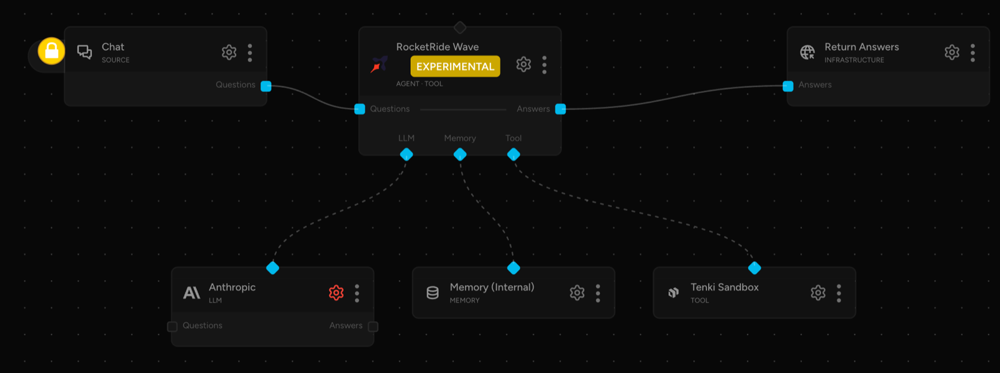

# tool_tenki

A RocketRide tool node that gives an agent a disposable Linux virtual machine on
[Tenki Cloud](https://tenki.cloud) to run commands and code in, edit files, and work in a git
repository.

## What it does

Gives the pipeline one Tenki Sandbox microVM, created on the agent's first tool call and shared by
every call after it, so files and installed packages carry over. Pick it over `tool_python` when
the work needs a real operating system, and over `tool_daytona` when the machine should keep its
state for the whole session. The node puts no credentials inside the VM.

## Example pipelines

**Write a script and run it in a sandbox**

`chat → agent_rocketride (+ tool_tenki) → response_answers`

## As a tool

An agent calls these as `<node id>.<function>`, for example `tool_tenki_1.run_command`.
**Tool groups** chooses the published groups; empty publishes all three.

| Group | Function | What it does |
|---|---|---|
| `execution` | `run_command` | Run a shell command. |
| `execution` | `run_code` | Run a `python` or `javascript` snippet. |
| `filesystem` | `write_file` | Write a UTF-8 text file of up to 4,000,000 bytes. |
| `filesystem` | `edit_file` | Replace one exact, unique piece of text. |
| `filesystem` | `read_file` | Read a text file of up to 4,000,000 bytes. |
| `filesystem` | `list_files` | List a directory. |
| `filesystem` | `make_directory` | Create a directory and its parents. |
| `filesystem` | `delete_path` | Delete a file or directory. |
| `git` | `git_clone` | Clone a public repository, or a private one under the prefix. |
| `git` | `git_checkout` | Check out a branch, tag or commit. |
| `git` | `git_diff` | Show a diff. |
| `git` | `git_log` | Show commit history. |

Results flag `timed_out`, `truncated`, and any session change: `created`, `resumed`, `replaced`
(earlier files gone) or `ended`.

## Configuration

Only **API Key** is required; the generated Schema table lists every field and default. Three
fields need judgement.

### Allowed outbound domains

Restricts outbound traffic to the listed hostnames, on any port; empty leaves it open. List only
what the work needs, such as `pypi.org` and `files.pythonhosted.org` for pip: every listed host can
receive data. Entries are hostnames with at most one leading `*.`; anything else stops the
pipeline at startup.

### Secret policies

Names of [Tenki request policies](https://tenki.cloud/docs/secrets/request-policies) to attach.
Sandbox code puts a placeholder such as `secrets://GITHUB_TOKEN` in an HTTPS request, and Tenki
substitutes the value outside the VM, only where a policy allows. Policies require **Allowed
outbound domains** and a key with Secrets access. Tell the agent which placeholders it may use.
A policy cannot protect the value from an allowed destination, which receives it and can return it
([Tenki: troubleshooting](https://tenki.cloud/docs/sandbox/secrets#troubleshooting)).

### Private repositories: URL prefix / Private repositories: Tenki secret

Name a Tenki secret holding the HTTP Basic credential: the base64 of the whole string
`x-access-token:<token>`, where `<token>` is a read-only GitHub token. Narrow the prefix to what
its policy covers, such as `https://github.com/acme/`. The policy needs `GET` and `POST` rules for
that path and the `Authorization` header. `git_clone` then sends the placeholder for URLs under
the prefix only. Keep the token read-only: a push matches the `POST` rule. `git_clone` refuses
URLs carrying credentials, a query string or a fragment, because git stores the URL in
`.git/config`.

## Authentication

Create a Tenki workspace API key (`tk_...`) in the Tenki dashboard
([Tenki: API keys](https://tenki.cloud/docs/account/api-keys)), and set it as **API Key** or as
`${ROCKETRIDE_TENKI_APIKEY}`. It never enters the VM. Secret policies also need **Allow Secrets
access**, chosen when the key is created
([Tenki: access permissions](https://tenki.cloud/docs/secrets/manage-secrets#access-permissions)).
That access can change every secret and policy in the workspace, so give the node its own key.

## Notes

### Limits

> **Note:** these limits apply to every pipeline.
>
> - Every caller of a pipeline shares one VM; run one pipeline per user or trust boundary.
> - Output beyond 8 MiB is dropped and the command is stopped.
> - A process under `sudo` or with a cleared environment escapes that stop and runs until
>   **Execution Timeout**.
> - A session paused and resumed from outside the node can leave it unreachable until the pipeline
>   restarts.
> - Secret injection needs an image with Tenki's managed HTTPS trust.
> - IPv4 ranges in **Allowed outbound domains** are refused.
> - **Tool groups** are not a security boundary.

## Upstream docs

- [Tenki Sandbox: sessions](https://tenki.cloud/docs/sandbox/sessions)
- [Tenki Sandbox: secrets](https://tenki.cloud/docs/sandbox/secrets)
- [Tenki: pricing](https://tenki.cloud/docs/pricing)
- [Tenki: changelog](https://tenki.cloud/docs/changelog)

<!-- ROCKETRIDE:GENERATED:PARAMS START -->
<!-- Generated by nodes:docs-generate. Do not edit by hand. -->

## Schema

| Field | Type | Description | Default |
|---|---|---|---|
| `tenki.allow_domains` | `array` | **Allowed outbound domains** Restricts the sandbox's outbound traffic to these hostnames, such as pypi.org, on any port; one leading *. wildcard is accepted. Leave empty for open outbound access to any host and port. List every host the agent's work needs (pip needs pypi.org and files.pythonhosted.org, for example), and no more: a listed host is somewhere data can be sent. An entry Tenki would refuse (a URL, a port, an underscore) stops the pipeline at startup. | `[]` |
| `tenki.apikey` | `string` | **API Key** Tenki workspace API key (starts with tk_), from the API Keys screen in the Tenki dashboard. | `""` |
| `tenki.base_url` | `string` | **API URL** Tenki Sandbox API endpoint. Leave empty for the default (https://api.tenki.cloud). | `""` |
| `tenki.cpu_cores` | `integer` | **CPU Cores** Virtual CPUs for the sandbox VM, 1 to 16. 0 leaves it to Tenki: 2, or what the Image sets. | `0` |
| `tenki.disk_size_gb` | `integer` | **Disk Size (GB)** Root disk size, 5 to 100 GB. 0 leaves it to Tenki: 5, or the Image's own disk. Tenki recommends 20 for agents that clone repositories and install dependencies. | `0` |
| `tenki.exec_timeout_secs` | `integer` | **Execution Timeout (seconds)** Max seconds a single run_command/run_code call may take. | `120` |
| `tenki.git_auth_secret` | `string` | **Private repositories: Tenki secret** Name of the Tenki secret holding the HTTP Basic credential for the repositories under the prefix above: for GitHub, the base64 of the whole string x-access-token:<token>, where <token> is a read-only token for those repositories (see the README). Only the name is set here; the value stays in Tenki, which adds it outside the VM. Requires Secret policies and Allowed outbound domains. Leave empty to clone public repositories only. | `""` |
| `tenki.git_auth_url` | `string` | **Private repositories: URL prefix** git_clone clones the private repositories under this https prefix, such as https://github.com/acme/, with the Tenki secret named below as their credential; clones of anything else are sent with no credential, as before. Only used when a secret is named. Make an attached secret policy cover the same URLs: a clone under the prefix that no policy covers is refused by Tenki (403 secret_injection_denied), public repositories included. The host must be in Allowed outbound domains. | `"https://github.com/"` |
| `tenki.image` | `string` | **Image** Registry image to start the sandbox from, such as a template build like myworkspace/my-node-env. Leave empty for Tenki's base image. | `""` |
| `tenki.label` | `string` | **Label** A name for this node instance, put into its sessions' names (rocketride-tool-tenki-<label>-<suffix>) and metadata (label). With several Tenki Sandbox nodes in one pipeline, this is what tells their sessions apart in the Tenki dashboard or in anything that lists them. 1 to 32 lowercase letters, digits or -, starting with a letter or digit; a value outside that stops the pipeline at startup. Leave empty for none. | `""` |
| `tenki.max_duration_minutes` | `integer` | **Max Duration (minutes)** How long a session may run before Tenki pauses it, set when the session is created, and the only thing that stops an unused session from billing compute: Tenki has no idle timeout. Size it as the cost backstop for a session the pipeline never shuts down, for example after an engine crash. A paused session keeps its files and memory, and the next tool call resumes it for another period of the same length, so this limits one stretch of running, not total spend. A pause cuts off any command still running, so keep it longer than the Execution Timeout. | `60` |
| `tenki.max_output_chars` | `integer` | **Max Output (characters)** Output longer than this is truncated before being returned to the agent. | `50000` |
| `tenki.memory_mb` | `integer` | **Memory (MB)** Memory for the sandbox VM, 512 to 65536 MB; an odd number is rounded down, since Tenki requires an even one. 0 leaves it to Tenki: 4096, or what the Image sets. | `0` |
| `tenki.pause_retention_hours` | `integer` | **Pause Retention (hours)** How long Tenki keeps a paused session's memory and files before discarding them. Tenki's own default is seven days; a session the pipeline left behind should not hold its code that long. A resume within this time continues where the session left off. | `24` |
| `tenki.secret_policies` | `array` | **Secret policies** Names of Tenki request policies to attach, for transparent secret injection. Code in the sandbox uses a placeholder such as secrets://GITHUB_BASIC, and Tenki puts the real value, outside the VM, only into requests a policy allows; a service a policy allows can still send the credential back in its response. For private repositories, name the secret under Private repositories below; git_clone then sends Authorization: Basic secrets://NAME (see the README). Create the secrets and policies in Tenki first; the API key needs Secrets access. Requires Allowed outbound domains: a pipeline with policies and no allowlist does not start. Leave empty to attach none. | `[]` |
| `tenki.toolGroups` | `array` | **Tool groups** Which groups of Tenki Sandbox tools this node publishes to the agent: <b>execution</b> (run commands and code), <b>filesystem</b> (write, edit, read and list files, make directories, and delete files or directories) and <b>git</b> (clone, check out, diff and log). <b>Leave this empty to publish all three</b> (12 tools). Naming groups publishes only those (this narrows what the agent is offered; it is not a security boundary, since git can run a command the agent configures inside the VM), and a value that names only unknown groups stops the pipeline at startup. | `[]` |

## Dependencies

- `tenki` `==1.4.1`

## Source

[<svg viewBox="0 0 16 16" width="15" height="15" fill="currentColor" aria-hidden="true" style="vertical-align:-0.15em;margin-right:0.35em"><path d="M8 0C3.58 0 0 3.58 0 8c0 3.54 2.29 6.53 5.47 7.59.4.07.55-.17.55-.38 0-.19-.01-.82-.01-1.49-2.01.37-2.53-.49-2.69-.94-.09-.23-.48-.94-.82-1.13-.28-.15-.68-.52-.01-.53.63-.01 1.08.58 1.23.82.72 1.21 1.87.87 2.33.66.07-.52.28-.87.51-1.07-1.78-.2-3.64-.89-3.64-3.95 0-.87.31-1.59.82-2.15-.08-.2-.36-1.02.08-2.12 0 0 .67-.21 2.2.82.64-.18 1.32-.27 2-.27.68 0 1.36.09 2 .27 1.53-1.04 2.2-.82 2.2-.82.44 1.1.16 1.92.08 2.12.51.56.82 1.27.82 2.15 0 3.07-1.87 3.75-3.65 3.95.29.25.54.73.54 1.48 0 1.07-.01 1.93-.01 2.2 0 .21.15.46.55.38A8.013 8.013 0 0016 8c0-4.42-3.58-8-8-8z"/></svg> View source](https://github.com/rocketride-org/rocketride-server/tree/develop/nodes/src/nodes/tool_tenki)
<!-- ROCKETRIDE:GENERATED:PARAMS END -->
