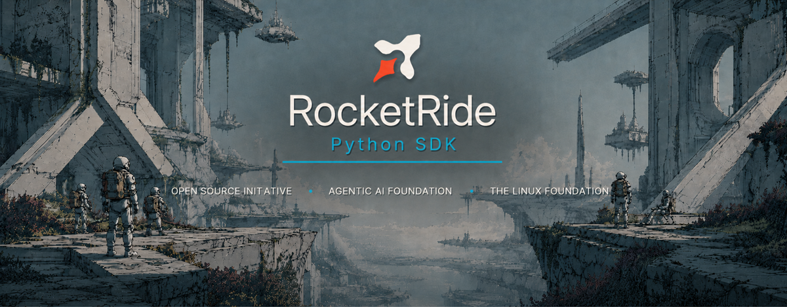

<!-- GENERATED by `./builder docs:export` — DO NOT EDIT. Source: docs/public/python/README.md -->

# RocketRide Python SDK

<p align="center">
  
</p>

<p align="center">
  RocketRide is an open source AI meta-harness with an enterprise-grade runtime built on C++, for companies and pro-builders building durable AI at production scale. Python SDK and CLI.
</p>

<p align="center">
  <a href="https://pypi.org/project/rocketride/"></a>
  <a href="https://github.com/rocketride-org/rocketride-server"></a>
  <a href="https://discord.gg/PMXrtenMsY"></a>
  <a href="https://github.com/rocketride-org/rocketride-server/blob/develop/LICENSE"></a>
</p>

**Full documentation: [docs.rocketride.ai/clients/python](https://docs.rocketride.ai/clients/python)** — guides, the complete API reference, and worked examples.

## Quick Start

```bash
pip install rocketride
```

```python
import asyncio
from rocketride import RocketRideClient


async def main():
    async with RocketRideClient(uri='https://api.rocketride.ai', auth='my-key') as client:
        result = await client.use(filepath='pipeline.pipe')
        token = result['token']
        out = await client.send(token, 'Hello, pipeline!', objinfo={'name': 'input.txt'}, mimetype='text/plain')
        print(out)
        await client.terminate(token)


asyncio.run(main())
```

`send()` / `send_files()` are for pipelines whose **source** is `webhook` or `dropper`;
if your pipeline source is `chat`, use `client.chat()` instead. Don't have a pipeline
yet? Build one visually with the [RocketRide IDE extension](https://docs.rocketride.ai/quickstart/ide-walkthrough).

The SDK is async-first (built on `asyncio` and `websockets`), includes the
`rocketride` [CLI](https://docs.rocketride.ai/connect/cli), and covers the full
engine surface: pipeline execution, streaming data, chat, deployments with cron
schedules, server-side file storage, and run-log replay.

## What is RocketRide?

[RocketRide](https://rocketride.ai) is an open source AI meta-harness with an enterprise-grade runtime built on C++, for companies and pro-builders building durable AI at production scale. It spans the full AI Development Lifecycle (AIDLC): build,
stage, test, release and maintain. Its rapidly growing node library includes agents,
models, vector/graph/SQL databases, OCR, tools, data stores, NER and more. MIT licensed. Self-host on your own infrastructure or deploy to RocketRide Cloud.

## Configuration

| Variable | Description |
| --- | --- |
| `ROCKETRIDE_URI` | Server URI (e.g. `wss://api.rocketride.ai` or `ws://localhost:5565`) |
| `ROCKETRIDE_APIKEY` | API key for authentication |

All constructor options, timeouts, and reconnection behavior:
[Configuration](https://docs.rocketride.ai/clients/python/configuration).

## Documentation

- [Overview & quickstart](https://docs.rocketride.ai/clients/python)
- [Running pipelines](https://docs.rocketride.ai/clients/python/pipelines) · [Sending data](https://docs.rocketride.ai/clients/python/data) · [Chat](https://docs.rocketride.ai/clients/python/chat)
- [Deployments](https://docs.rocketride.ai/clients/python/deploy) · [File storage](https://docs.rocketride.ai/clients/python/storage) · [Run logs](https://docs.rocketride.ai/clients/python/logs)
- [Error handling](https://docs.rocketride.ai/clients/python/errors) · [API reference](https://docs.rocketride.ai/clients/python/reference) · [Examples](https://docs.rocketride.ai/clients/python/examples)

## Links

- [Documentation](https://docs.rocketride.ai/clients/python)
- [GitHub](https://github.com/rocketride-org/rocketride-server)
- [Discord](https://discord.gg/PMXrtenMsY)
- [Release notes](https://docs.rocketride.ai/support/release-notes)

## License

MIT - see [LICENSE](https://github.com/rocketride-org/rocketride-server/blob/develop/LICENSE).
